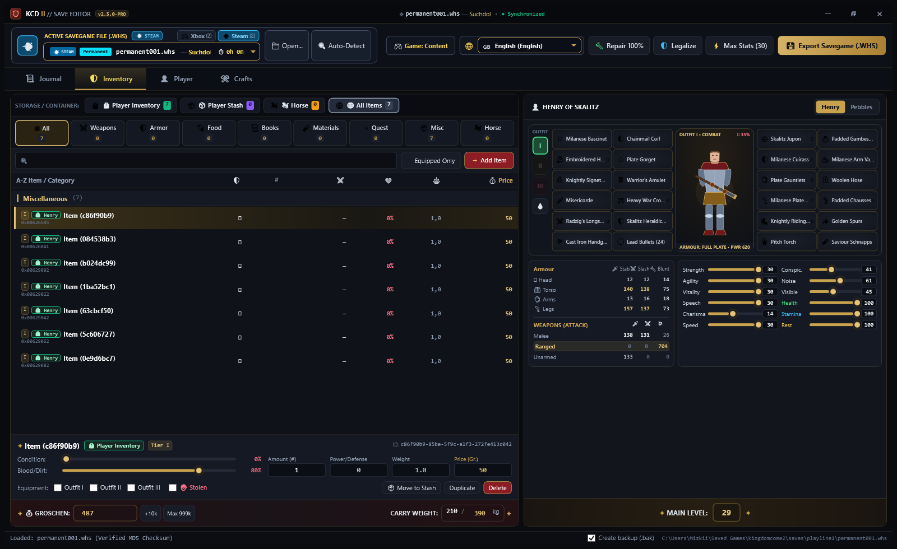
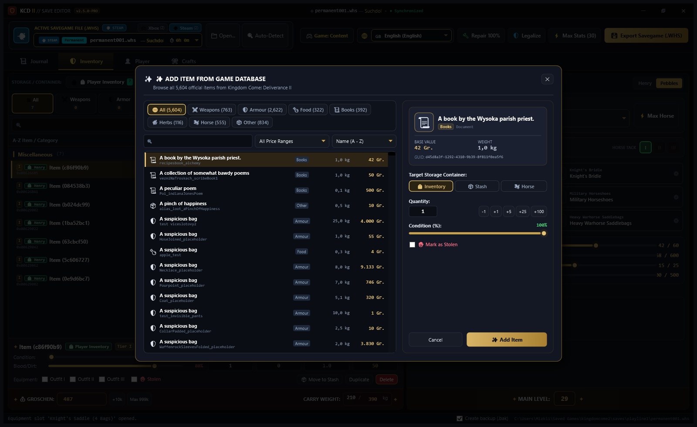
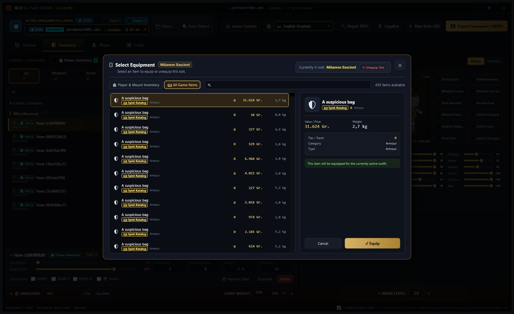
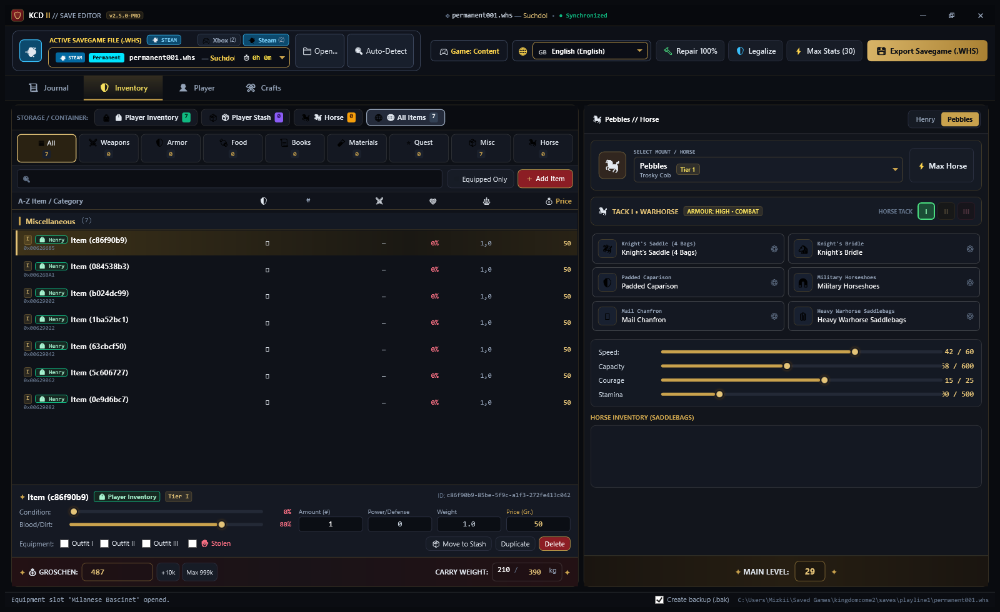
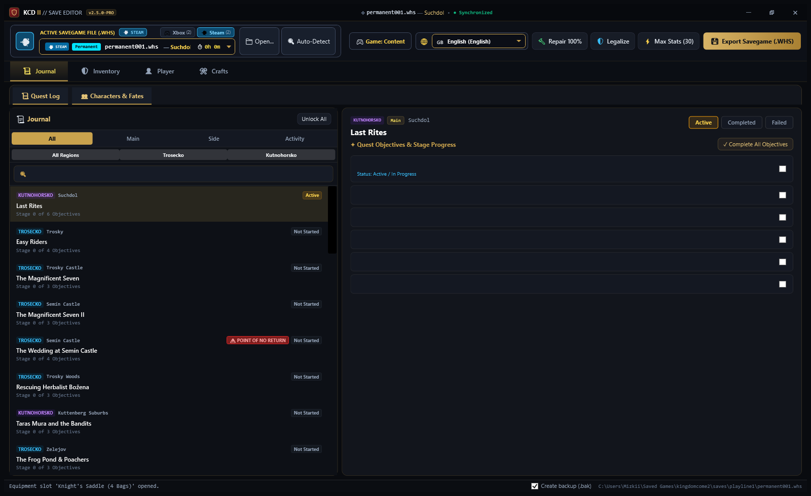
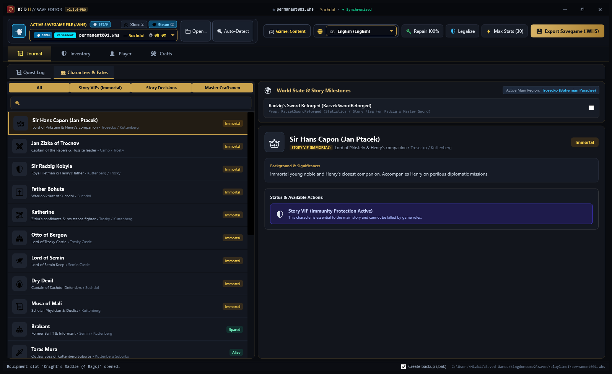
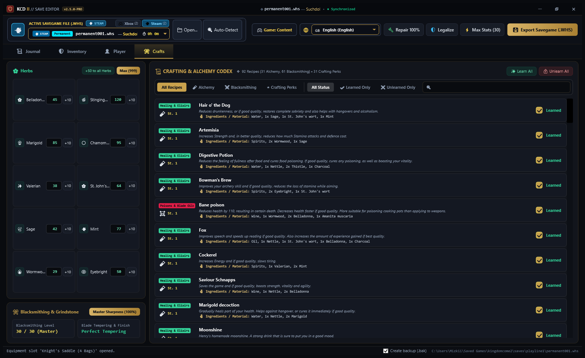
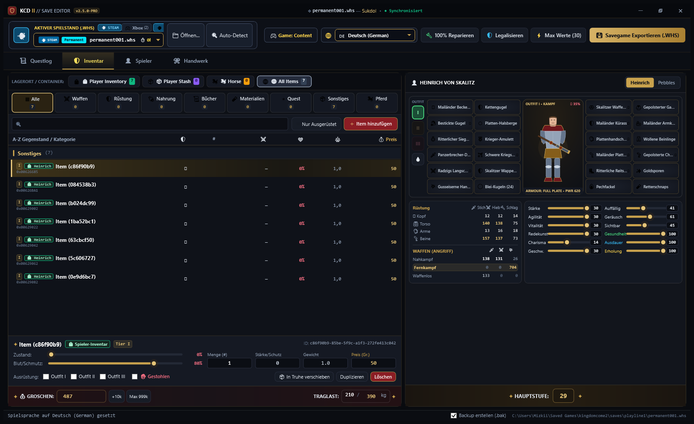

<div align="center">

# ⚔️ Kingdom Come: Deliverance II — SaveGame Editor

[](https://opensource.org/licenses/MIT)
[](https://github.com/Mizkii/KCD_2_SaveGAme_Editor/actions)
[-blue.svg)](#cross-platform-support)
[](#architecture)
[](#architecture)
[](https://github.com/Mizkii/KCD_2_SaveGAme_Editor/releases/latest)

**The ultimate high-performance, reverse-engineered desktop SaveGame Editor for *Kingdom Come: Deliverance II*.**  
Engineered with a native C++20 parsing engine and a modern dark-medieval .NET 10 WPF user interface.

[**🌐 Visit GitHub Pages Showcase**](https://mizkii.github.io/KCD_2_SaveGAme_Editor/) • [**⬇️ Download Latest Release**](https://github.com/Mizkii/KCD_2_SaveGAme_Editor/releases/latest) • [**📖 Documentation**](docs/ARCHITECTURE.md)

<br>



</div>

---

## 🌟 Key Features

### 🛡️ Equipment Paperdoll & Triple Outfits
* **16-Slot Armor Hierarchy**: Full equipment inspector covering Bascinet, Coif, Collar/Gorget, Torso Plate, Cuirass, Gambeson, Arm Armor, Gauntlets, Leg Plate, Mail Chausses, Hose, Boots, Spurs, Ring, and Amulet.
* **1-Click Outfit Switcher**: Rapidly switch Henry between **Outfit I (Combat)**, **Outfit II (Town)**, and **Outfit III (Hunting)**.
* **Dynamic Defense Matrix**: Real-time recalculation of Blunt (*Schlag*), Slash (*Hieb*), and Pierce (*Stich*) armor ratings.
* **Gothic Slot Picker Modal**: Click any equipment slot to open a dedicated selector modal filtering through inventory and the official 5,604-item game codex.

### 🐎 Pebbles Mount & Mutt Companion Management
* **6-Slot Interactive Tack Layout**: Customize your steed with Saddle, Bridle, Caparison, Horseshoes, Chanfron (*Rossharnisch*), and Saddlebags.
* **3 Tack Outfit Presets**: Switch your horse setup between **I Warhorse (Streitross)**, **II Travel (Reise)**, and **III Noble (Prunk)**.
* **Dynamic Mount Stats**: Inspect and adjust Speed, Capacity, Courage, and Stamina.
* **Dog Companion (Mutt) Manager**: Fine-tune Loyalty, Obedience, Nourishment, and Aggression sliders. Unlock all Houndmaster perks (*Hunting Dog*, *Watchdog*, *Clinch*, *Companion Solace*).

### 📦 Multi-Storage Inventory & 5,604 Item Codex Spawner
* **Multi-Container Switcher**: Inspect items located in **Player Inventory**, **Player Stash (Chest)**, or **Horse Saddlebags** with 14 category pill filters.
* **5,604 Item Official Codex**: Integrated bilingual database with instant search by name, GUID, or internal ID.
* **Item Manipulator**: Modify item condition (0%–100%), adjust blood/dirt accumulation, duplicate stacks, or delete items.
* **Theft Legalizer**: Strip stolen flags from items across all inventories in a single click with zero crime trace.

### 📜 Quest Log & Story Character Fates
* **Quest Progress Tree**: Filter quests by Main Quests, Side Quests, and Activities. Inspect active quest objectives and manually mark quests as Active, Completed, or Failed.
* **Point of No Return Alert**: Distinct warning badges for irreversible campaign milestones (e.g., *The Wedding at Semín Castle*).
* **Character Fates & Resurrector**: Track whether key story characters (Sir Radzig Kobyla, Sir Hans Capon, Father Bohuta, Theresa, etc.) are **Alive**, **Dead**, or **Missing**. Resurrect fallen NPCs with 1 click.

### ⚒️ Herbalism, Blacksmithing & Alchemy Autobrew
* **Herbalism Pouch**: Refill all 10 herb types (*Belladonna*, *Stinging Nettle*, *Marigold*, *Chamomile*, *Valerian*, *Sage*, *Mint*, *Wormwood*, *Eyebright*, *St. John's Wort*) with +50 or Max (999).
* **Master Blacksmithing**: Set weapon sharpening to 100% Master Sharpness and enable Perfect Tempering.
* **Alchemy Recipe Codex**: Instant unlock of 92 crafting recipes and auto-brew perks (*Routine II*).

### 🔒 Save Integrity & Cross-Platform Support
* **Native CryEngine XMLCPB Recalculation**: Automatic recalculation of the 64-byte XMLCPB trailer and RFC 1321 MD5 integrity checksums to prevent "Corrupted Save" warnings.
* **Automatic Safety Backups**: Every write creates a timestamped `.bak` copy (e.g., `save008.whs.bak_20261023_120000`).
* **Steam & Xbox Game Pass PC**: Automatic discovery and scanning of Steam save directories (`%USERPROFILE%\Saved Games\kingdomcome2\saves\`) and Xbox Game Pass WGS container folders.
* **Bilingual UI**: Complete native support for both **English** and **German (*Deutsch*)**.

---

## 📸 Screenshots Showcase

<div align="center">

| Henry Paperdoll & Defense Matrix | 5,604 Item Codex Spawner |
| :---: | :---: |
|  |  |

| Slot Equipment Selector Modal | Horse Tack Equipment & Presets |
| :---: | :---: |
|  |  |

| Quest Log & Objectives | Character Fates & NPC Resurrector |
| :---: | :---: |
|  |  |

| Crafting, Alchemy & Herbs Pouch | German Localization Overview |
| :---: | :---: |
|  |  |

</div>

---

## 🏗️ Technical Architecture

The editor is architected as a high-performance **dual-tier system**:

```
KCD_2_SaveGAme_Editor/
├── .github/workflows/          # GitHub Actions CI/CD (Builds C++ Core & .NET 10 WPF UI)
├── CMakeLists.txt              # CMake configuration for native C++ library & CLI
├── build.bat                   # Portable 1-click build script
├── include/
│   ├── kcd2_save_api.h         # Clean C ABI interface contract
│   └── kcd2_types.h            # Core data structures and enum definitions
├── src/
│   ├── core/                   # Native C++20 Core Engine (KCD2SaveCore.dll)
│   │   ├── api/                # Exported C API functions
│   │   ├── container/          # .whs format parsing, zlib chunking, MD5 trailer signing
│   │   ├── crypto/             # RFC 1321 MD5 hash calculation
│   │   ├── compression/        # High-throughput miniz zlib deflate implementation
│   │   └── model/              # SaveSession, inventory manager, quest progress
│   ├── cli/                    # C++ Command-line verification harness (kcd2_cli.exe)
│   └── ui/                     # Modern C# .NET 10 WPF Desktop Application
│       ├── Interop/            # P/Invoke native bindings
│       ├── ViewModels/         # MVVM presentation layer
│       ├── Views/              # Custom controls, modals, and templates
│       ├── Services/           # GameDataService (5,604 items), AppSettings
│       └── MainWindow.xaml     # Gothic dark UI layout
└── docs/                       # GitHub Pages Website & Documentation
    ├── index.html              # Responsive interactive landing page
    ├── style.css               # Medieval gothic styling
    ├── app.js                  # Lightbox and bilingual engine
    └── screenshots/            # High-resolution feature captures
```

---

## 🚀 Building from Source

### Prerequisites
* **Windows 10 / 11 64-bit**
* **CMake 3.20+**
* **Visual Studio 2022+** (with C++ Desktop Development workload)
* **.NET 10 SDK** (or .NET 8.0+)

### 1-Click Build
Run the provided batch script from the repository root:
```cmd
build.bat
```

### Manual Build via Command Line
```cmd
# 1. Configure and compile C++ native core
cmake -B build -S . -DCMAKE_BUILD_TYPE=Release -A x64
cmake --build build --config Release --target KCD2SaveCore

# 2. Build and publish .NET 10 WPF UI
dotnet publish src/ui/KCD2SaveEditor.UI.csproj -c Release -r win-x64 --self-contained false -o publish

# 3. Copy Native Core DLL into publish output
copy build\bin\Release\KCD2SaveCore.dll publish\

# 4. Launch Editor
publish\KCD2SaveEditor.UI.exe
```

---

## 🔒 Save File Integrity Specification

Kingdom Come: Deliverance II `.whs` save files consist of concatenated RFC 1950 ZLIB chunk streams (32KB decompressed blocks) terminated by a 64-byte XMLCPB trailer block (`0XBP` / `0x50425830`).

The game validates the integrity of every save using an internal MD5 checksum:
$$\text{MD5}\Big(\text{file\_body} + \text{trailer}[:4] + 0^{16} + \text{trailer}[20:]\Big)$$

`KCD2SaveCore` automatically zeroes out the signature offset, recalculates the cryptographic MD5 hash over the uncompressed chunks and modified tables, and rewrites the trailer upon saving to ensure 100% game compatibility.

---

## 📄 License

This project is licensed under the [MIT License](LICENSE).

---

## ⚖️ Disclaimer

*Kingdom Come: Deliverance II* is a registered trademark of **Warhorse Studios** and **PLAION**. This project is an independent open-source community tool and is not affiliated with, endorsed by, or sponsored by Warhorse Studios or PLAION. Always backup your original save games before editing.
